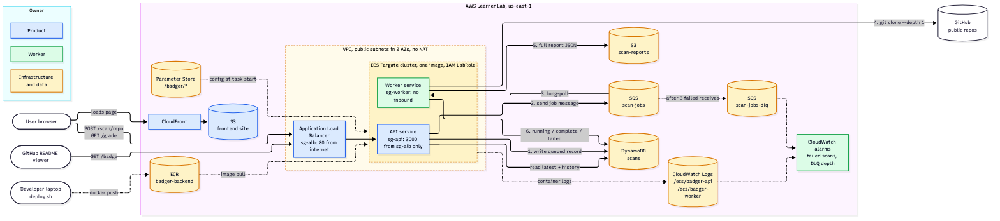
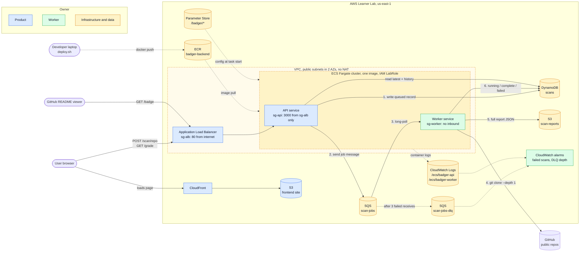

# Architecture

Target AWS architecture for Milestone 3. Nothing is deployed yet; locally, the AWS services are emulated (see [Local mapping](#local-mapping)). Message and record formats are in [`contracts.md`](contracts.md). Earlier versions of this diagram are kept under [Revisions](#revisions).





Solid arrows are the request flow; dotted arrows are deployment, configuration, logging, and failure handling. Colors show which role owns each component (see [Ownership](#ownership)).

## Flow

1. The user submits a GitHub URL. The API validates it, writes a `queued` scan record, sends a job message to SQS, and returns `202`.
2. The worker long-polls SQS, marks the record `running`, shallow-clones the repo into a temp directory, and runs the provided SAST scanner on its JS/TS files.
3. The worker grades the findings, uploads the full report to S3, writes the summary record as `complete` (or `failed`), and only then deletes the message.
4. The frontend polls `GET /grade/...` until the scan finishes. README badges call `GET /badge/...`, which reads the latest record from DynamoDB.

API and worker are the same image with different commands ([decision 0002](decisions/0002-single-image-api-and-worker.md)), so they scale independently.

## Operations

- **Deploy:** `deploy.sh` (in `infra/`, Milestone 3) builds the image, pushes it to ECR, and updates the stack. Learner Lab credentials rotate each session, so deploys are run by hand, not from CI.
- **Configuration:** queue URL, table and bucket names, and clone limits live in Parameter Store under `/badger/`. ECS injects them as environment variables at task start, the same names as `.env.example`. `AWS_ENDPOINT_URL` is not set, so `aws/clients.js` uses the real AWS endpoints.
- **Permissions:** Learner Lab does not allow creating IAM roles, so both task role and task execution role are the provided `LabRole`.
- **Network:** the load balancer is the only component that accepts inbound traffic from the internet. The API accepts traffic only from the load balancer's security group; the worker accepts none, and needs outbound HTTPS only (GitHub and AWS APIs).
- **Logs:** each service writes to its own CloudWatch log group (`/ecs/badger-api`, `/ecs/badger-worker`) with limited retention.
- **Failure handling:** the worker records expected failures (bad repo, clone timeout, oversized repo) as `failed` and deletes the message. A message that is received three times without being deleted (the worker crashed or hung) moves to the dead-letter queue `scan-jobs-dlq`. CloudWatch alarms watch the DLQ and failed scans.

### Open items

These parts of the diagram are proposals, to be settled in decision records before Milestone 3 deploys:

- **Networking:** public subnets with public IPs and no NAT gateway (a NAT gateway is a fixed hourly cost against the Learner Lab budget), with inbound access restricted by security groups. Alternative: private subnets with NAT or VPC endpoints.
- **Deploy tooling:** CloudFormation templates driven by `deploy.sh`, or plain AWS CLI scripts.
- **Public API exposure:** browser and badge requests go straight to the load balancer; routing them through CloudFront is an option. HTTPS needs a certificate, which may not be possible in Learner Lab.
- **Alarm design:** owned by the Worker role (metric, thresholds, notification).

## Ownership

| Role | Components |
|---|---|
| Product (API + frontend) | API service, load balancer, CloudFront and the frontend bucket |
| Worker | Worker service, SQS consumption, failure handling, CloudWatch alarms |
| Infrastructure and data | VPC and security groups, ECS cluster, SQS queues, DynamoDB, report bucket, ECR, Parameter Store, log groups, deploy scripts, this diagram |

## Local mapping

| AWS (target) | Local (`docker compose`) |
|---|---|
| SQS, DynamoDB, S3 | `localstack` service running Floci ([decision 0001](decisions/0001-localstack-for-local-dev.md)), resources created by `infra/localstack/init.sh` |
| SQS dead-letter queue | `scan-jobs-dlq`, also created by `init.sh`, with the same redrive policy (3 receives) |
| ECS API service | `api` service, port 3000 |
| ECS worker service | `worker` service |
| ECR | Image built locally by `docker compose` |
| Parameter Store | `.env` (copied from `.env.example`) |
| CloudWatch Logs | `docker compose logs` |
| CloudFront + S3 frontend | `frontend/index.html` served by the API (until Milestone 4) |
| Load balancer, VPC, security groups | None; direct to `localhost:3000` |

To check the emulated data layer end to end, run `docker compose run --rm api npm run smoke`.

## Revisions

| Version | Milestone | What changed | Diagram |
|---|---|---|---|
| v2 (current) | Milestone 3 plan | Added VPC and security groups, ECR, Parameter Store, CloudWatch logs and alarms, SQS dead-letter queue, deploy path, and role ownership colors | above |
| v1 | Milestone 1 skeleton | Core request flow: load balancer, API and worker tasks, SQS, DynamoDB, S3, GitHub | [PNG](architecture-history/v1-skeleton.png), [source](architecture-history/v1-skeleton.mmd) |

## Updating the diagram

The Mermaid block above is the source. After editing it, regenerate `architecture.png` from the repo root:

```sh
sed -n '/^```mermaid$/,/^```$/p' docs/architecture.md | sed '1d;$d' \
  | npx -y @mermaid-js/mermaid-cli@12.0.0 -i - -o docs/architecture.png -b white -s 2
```

For a significant change, first archive the current version: copy the Mermaid block to `architecture-history/v<N>-<name>.mmd` and `architecture.png` to `architecture-history/v<N>-<name>.png`, then add a row to [Revisions](#revisions).
