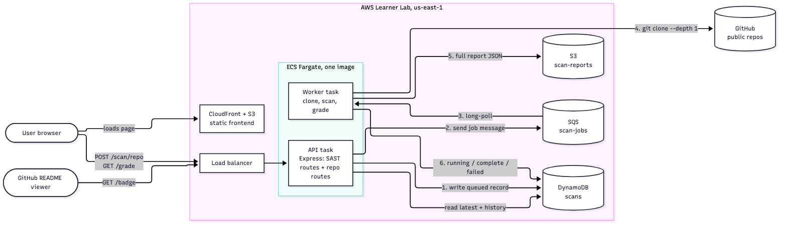
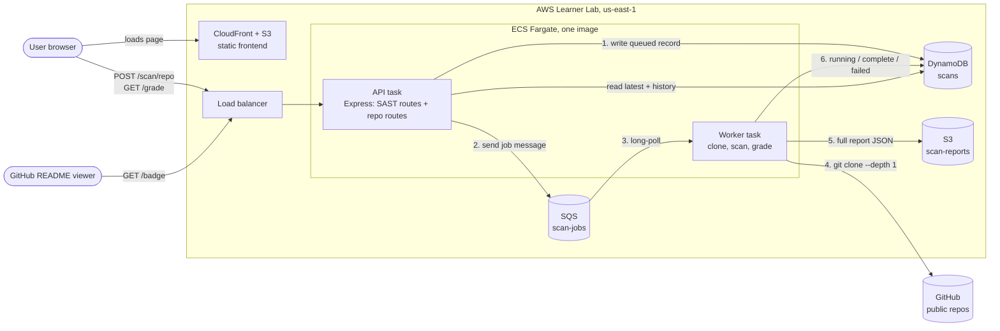

# Architecture

Target AWS architecture (Milestone 3+). Nothing is deployed yet; locally, every AWS service below is emulated (see [Local mapping](#local-mapping)). Message and record formats are in [`contracts.md`](contracts.md).





## Flow

1. The user submits a GitHub URL. The API validates it, writes a `queued` scan record, sends a job message to SQS, and returns `202`.
2. The worker long-polls SQS, marks the record `running`, shallow-clones the repo into a temp directory, and runs the provided SAST scanner on its JS/TS files.
3. The worker grades the findings, uploads the full report to S3, writes the summary record as `complete` (or `failed`), and only then deletes the message.
4. The frontend polls `GET /grade/...` until the scan finishes. README badges call `GET /badge/...`, which reads the latest record from DynamoDB.

API and worker are the same image with different commands ([decision 0002](decisions/0002-single-image-api-and-worker.md)), so they scale independently. The load balancer, and how the API is exposed publicly, are assumptions to confirm in Milestone 3.

## Local mapping

| AWS (target) | Local (`docker compose`) |
|---|---|
| SQS, DynamoDB, S3 | `localstack` service running Floci ([decision 0001](decisions/0001-localstack-for-local-dev.md)), resources created by `infra/localstack/init.sh` |
| ECS API task | `api` service, port 3000 |
| ECS worker task | `worker` service |
| CloudFront + S3 frontend | `frontend/index.html` served by the API (until Milestone 4) |
| Load balancer | none; direct to `localhost:3000` |

## Updating the diagram

The Mermaid block above is the source. After editing it, regenerate `architecture.png` from the repo root:

```sh
sed -n '/^```mermaid$/,/^```$/p' docs/architecture.md | sed '1d;$d' \
  | npx -y @mermaid-js/mermaid-cli@12.0.0 -i - -o docs/architecture.png -b white -s 2
```
